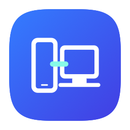
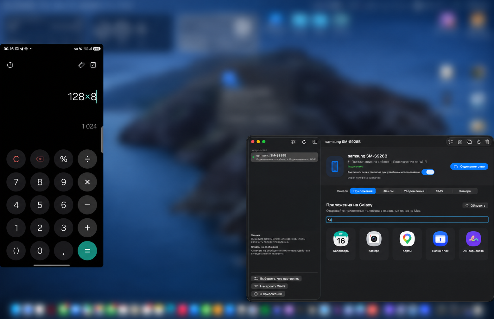

<div align="center">
  
  <h1>Galaxy Bridge</h1>
  <p>Your Samsung phone on your Mac.<br>Ваш Samsung на Mac.</p>
  <p>
    <a href="https://github.com/XopMC/GalaxyBridge/releases/tag/0.1.1"></a>
    
    
    
    <a href="LICENSE"></a>
  </p>
  <p><a href="#english"><strong>English</strong></a> | <a href="#russian"><strong>Русский</strong></a></p>
  <p><a href="https://github.com/XopMC/GalaxyBridge/releases/tag/0.1.1">Download / Скачать 0.1.1</a></p>
</div>

<p align="center">
  
</p>

<details>
  <summary>App catalog on Mac / Каталог приложений на Mac</summary>
  <p></p>
</details>

<a id="english"></a>

## English

Galaxy Bridge connects your Samsung phone to your Mac. Use phone apps alongside your Mac apps, answer notifications, copy text and images, and move files between devices. Everything connects locally, without an account or cloud relay.

**0.1.1 is an early preview.** Requires **macOS 14+ on Apple Silicon** and a **Samsung phone with Android 12+**.

### Features

- Mirror the phone over USB or Wireless ADB and control it with your mouse and keyboard.
- Open phone apps in separate Mac windows.
- Play phone audio on the Mac and record the screen.
- Share text and copied images through the clipboard; transfer files in both directions.
- Read notifications and reply when the original notification supports it.
- Keep the physical phone display off during remote use. Enabled by default; this does not lock Android.

The apps follow your system language, with English as a fallback. ADB is included in the Mac app.

### Download and start

[Download DMG](https://github.com/XopMC/GalaxyBridge/releases/download/0.1.1/GalaxyBridge-0.1.1-macOS-arm64.dmg) · [Download APK](https://github.com/XopMC/GalaxyBridge/releases/download/0.1.1/GalaxyBridge-0.1.1-direct.apk) · [Release notes](docs/public/release-notes-0.1.1.md)

1. Open the DMG, drag Galaxy Bridge to **Applications**, and install the APK on your phone.
2. Enable **USB debugging** in Android Developer options, connect a USB cable, and approve the Mac on your phone.
3. Open the phone Helper and scan the pairing QR from the Mac app. For wireless use, follow **Wi-Fi setup** in the Mac app.

The Mac app is locally signed and not Apple-notarized. See the [installation guide](docs/public/install.md) for first launch and permissions.

### Limitations

Some apps block screen capture or audio, and app-window compatibility varies. Full SMS history, direct SMS sending and a virtual webcam are not available yet.

### Build from source

Install the [build prerequisites](docs/public/build.md), then run:

```sh
cmake --preset macos-arm64-release
cmake --build --preset macos-arm64-release --target native macos-app android-apk
```

### TODO

- [ ] Simpler Wi-Fi setup and better reconnection.
- [ ] Finish nearby connection and optional internet sharing for 0.1.2.
- [ ] Improve app compatibility and translations.
- [ ] Full SMS support and a virtual webcam.

[Contributions](CONTRIBUTING.md), bug reports and translation fixes are welcome.

---

<a id="russian"></a>

## Русский

Galaxy Bridge связывает Samsung с Mac. Открывайте приложения телефона рядом с приложениями Mac, отвечайте на уведомления, копируйте текст и изображения, передавайте файлы между устройствами. Подключение работает локально, без аккаунта и облачного сервера.

**0.1.1 — предварительный выпуск.** Нужны **macOS 14+ на Apple Silicon** и **Samsung с Android 12+**.

### Возможности

- Трансляция экрана по USB или Wireless ADB с управлением мышью и клавиатурой.
- Приложения телефона в отдельных окнах Mac.
- Звук телефона на Mac и запись экрана.
- Общий буфер для текста и скопированных изображений, передача файлов в обе стороны.
- Просмотр уведомлений и ответы, если исходное уведомление их поддерживает.
- Выключение физического дисплея телефона при удалённой работе. Включено по умолчанию; Android при этом не блокируется.

Приложения используют системный язык, а если перевода нет — английский. ADB уже встроен в приложение для Mac.

### Скачать и запустить

[Скачать DMG](https://github.com/XopMC/GalaxyBridge/releases/download/0.1.1/GalaxyBridge-0.1.1-macOS-arm64.dmg) · [Скачать APK](https://github.com/XopMC/GalaxyBridge/releases/download/0.1.1/GalaxyBridge-0.1.1-direct.apk) · [Что нового](docs/public/release-notes-0.1.1.md#russian)

1. Откройте DMG, перенесите Galaxy Bridge в **«Программы»** и установите APK на телефон.
2. Включите **отладку по USB** в настройках разработчика Android, подключите кабель и подтвердите доступ для Mac на телефоне.
3. Откройте Helper на телефоне и отсканируйте QR сопряжения из приложения Mac. Для работы без кабеля пройдите **настройку Wi-Fi** в приложении Mac.

У приложения для Mac локальная подпись без нотарификации Apple. Первый запуск и разрешения описаны в [инструкции по установке](docs/public/install.md#russian).

### Ограничения

Некоторые приложения запрещают захват экрана или звука; работа в отдельных окнах тоже зависит от приложения. Полной истории SMS, прямой отправки SMS и виртуальной веб-камеры пока нет.

### Сборка из исходников

Установите [зависимости](docs/public/build.md#russian), затем выполните:

```sh
cmake --preset macos-arm64-release
cmake --build --preset macos-arm64-release --target native macos-app android-apk
```

### TODO

- [ ] Упростить настройку Wi-Fi и улучшить переподключение.
- [ ] Доделать подключение поблизости и необязательную раздачу интернета для 0.1.2.
- [ ] Улучшить совместимость приложений и переводы.
- [ ] Добавить полноценную работу с SMS и виртуальную веб-камеру.

Буду рад [участию в разработке](CONTRIBUTING.md), сообщениям об ошибках и исправлениям переводов.

---

Author / Автор: **Mikhail Khoroshavin / Михаил Хорошавин ([XopMC](https://github.com/XopMC))** · [Telegram](https://t.me/xopmc)

[MIT License](LICENSE) · [Third-party licenses / Лицензии компонентов](third_party/LICENSES.md)

Independent project, not affiliated with Samsung or Apple. / Независимый проект, не связанный с Samsung или Apple.
