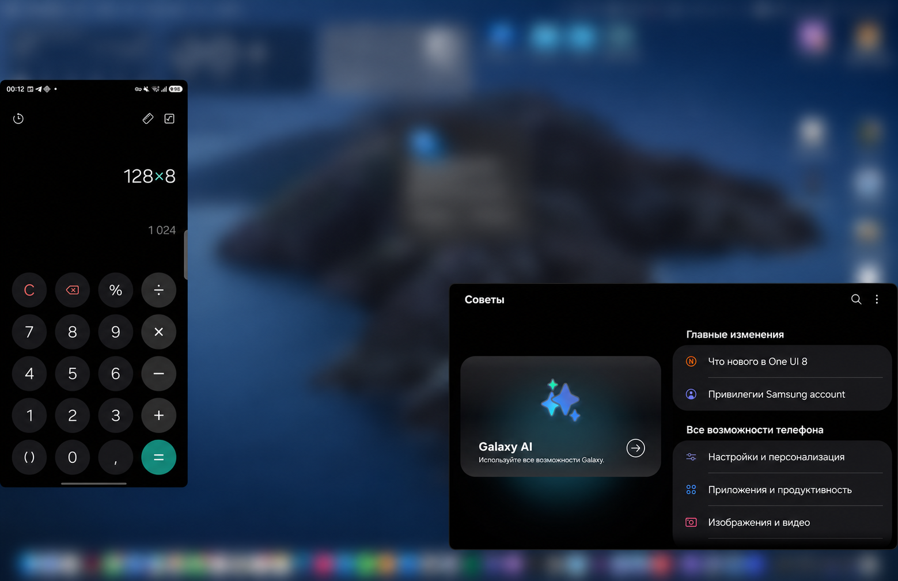

# Galaxy Bridge 0.1.0

[English](#english) | [Русский](#russian) · [Download](https://github.com/XopMC/GalaxyBridge/releases/tag/0.1.0)

## English

The first public preview of Galaxy Bridge for Samsung phones and Apple Silicon Macs.

- Mirror and control your phone with a mouse and keyboard.
- Open phone apps in separate Mac windows.
- Play phone audio on the Mac and record the screen.
- Transfer files both ways, share clipboard text, and read or reply to supported notifications.

Install the DMG on your Mac and APK on your phone, enable USB debugging, and follow the pairing prompts. Requires macOS 14+ and Android 12+; ADB is included.

Audio and app compatibility vary. Full SMS support and a virtual webcam are not included. The Mac app is locally signed without Apple notarization; see [installation](https://github.com/XopMC/GalaxyBridge/blob/main/docs/public/install.md).

Newer versions are available in [Releases](https://github.com/XopMC/GalaxyBridge/releases).

## Русский

Первый публичный предварительный выпуск Galaxy Bridge для телефонов Samsung и Mac с Apple Silicon.

- Трансляция экрана телефона и управление мышью и клавиатурой.
- Приложения телефона в отдельных окнах Mac.
- Звук телефона на Mac и запись экрана.
- Передача файлов в обе стороны, общий текстовый буфер, просмотр уведомлений и ответы, если они поддерживаются.

Установите DMG на Mac и APK на телефон, включите отладку по USB и следуйте подсказкам сопряжения. Нужны macOS 14+ и Android 12+; ADB уже встроен.

Звук и совместимость зависят от приложения. Полной работы с SMS и виртуальной веб-камеры пока нет. У Mac-приложения локальная подпись без нотарификации Apple; подробнее — в [инструкции](https://github.com/XopMC/GalaxyBridge/blob/main/docs/public/install.md#russian).

Новые версии доступны в [Releases](https://github.com/XopMC/GalaxyBridge/releases).
